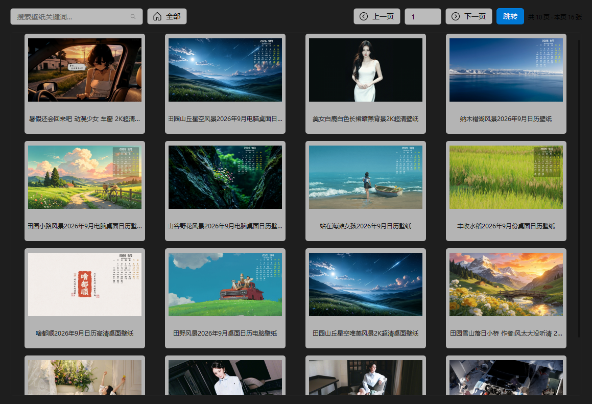
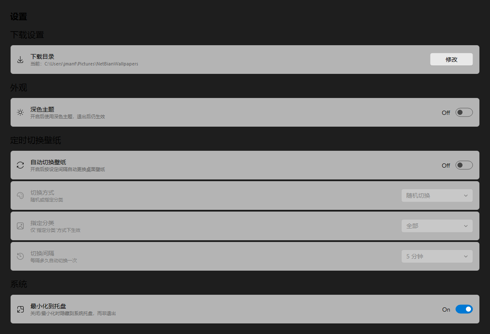

# 彼岸桌面壁纸浏览器 · NetBianWallpaper

一个 Windows 桌面壁纸浏览器，界面采用 **WinUI 3 / Fluent 风格**，数据来源于 [彼岸图网](https://www.netbian.com)。支持分类浏览、搜索、大图预览、一键下载与设为桌面壁纸，并提供磨砂玻璃、自动配色、定时切换等个性化能力。

> 版本：V1.0 ｜ 作者：你的大大大魔头 ｜ 数据来源：彼岸图网（鸣谢）

---

## 🖼 界面预览

| 主界面（壁纸浏览） | 设置页 |
|---|---|
|  |  |

---

## ✨ 功能特性

- 🖼 **分类浏览 + 分页 + 搜索**：内置 19 个分类（动漫、游戏、风景、美女、动物、花卉……），支持关键字搜索。
- 🔍 **大图预览**：滚轮缩放、拖拽平移、适应窗口 / 原始大小 / 最大化一键切换。
- 💾 **下载 / 设为壁纸**：壁纸一键保存到本地，或直接设置为 Windows 桌面壁纸。
- ⏰ **定时切换壁纸**：按自定义时间间隔自动更换桌面壁纸。
- 🪟 **磨砂玻璃主题**：抓取当前壁纸做高斯模糊 + 半透明蒙版，模糊强度（5~100）与不透明度（20~100%）均可调。
- 🎨 **跟随壁纸自动配色**：自动提取壁纸主色调，驱动窗口强调色与玻璃色。
- 🌗 **深浅主题 + 定时切换**：支持手动切换，也支持自定义时间段或按日出日落自动切换（内置 NOAA 简化算法，无需联网）。
- 📌 **系统托盘**：支持最小化到托盘，后台静默运行。
- 🔒 **单实例运行**：避免重复启动多个实例。

---

## 🛠 技术栈

| 模块 | 说明 |
|---|---|
| [PySide6](https://pypi.org/project/PySide6/) | Qt for Python 界面框架 |
| [PySide6-Fluent-Widgets](https://pypi.org/project/PySide6-Fluent-Widgets/) | Fluent / WinUI 风格组件库（qfluentwidgets） |
| [requests](https://pypi.org/project/requests/) / [curl_cffi](https://pypi.org/project/curl-cffi/) | 网络请求（curl_cffi 可模拟浏览器 TLS 指纹，降低被 WAF 拦截概率，可选） |
| [Pillow](https://pypi.org/project/Pillow/) | 图像处理（磨砂玻璃高斯模糊、主题色提取） |

> 目标平台：**Windows**（设壁纸、玻璃效果依赖 Win32 API）。

---

## 🚀 快速开始

### 环境要求

- Windows 10 / 11
- Python 3.9+

### 安装依赖

```bash
pip install PySide6 PySide6-Fluent-Widgets Pillow requests
# 可选：更稳的 TLS 指纹模拟
pip install curl_cffi
```

### 运行

```bash
python wallpaper.py
```

> 启动后添加 `--settings` 参数可直接跳转到设置页：`python wallpaper.py --settings`

---

## 📦 打包为 EXE

项目使用 [PyInstaller](https://pyinstaller.org/) 打包为单文件 Windows 可执行程序：

```bash
pip install pyinstaller
pyinstaller NetBianWallpaper.spec --noconfirm --clean
```

打包产物位于 `dist/NetBianWallpaper.exe`。

---

## 📁 目录结构

```
NetBianWallpaper/
├── wallpaper.py              # 主程序入口（界面 + 业务逻辑）
├── app_icon.py               # 应用图标模块（内嵌 PNG）
├── NetBianWallpaper.spec     # PyInstaller 打包配置
├── app.ico                   # 可执行文件图标
└── dist/
    └── NetBianWallpaper.exe  # 打包产物
```

---

## ⚠️ 免责声明

本项目仅供学习与交流使用。所有壁纸内容均来源于 [彼岸图网](https://www.netbian.com)，其版权归原作者及彼岸图网所有。请勿将获取的壁纸用于商业用途；如需商用，请联系版权方获取授权。

---

## 📄 许可证

代码采用 [MIT License](LICENSE) 开源。壁纸内容版权不包含在本许可证范围内。
